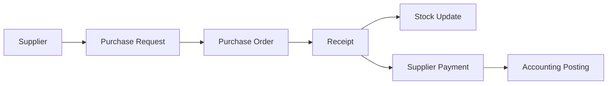
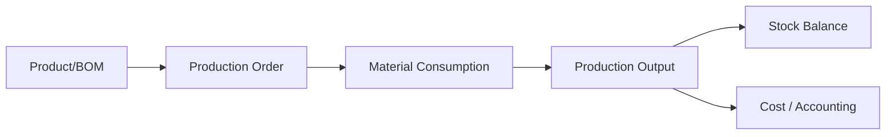

# Business Workflows

## Purchase workflow
1. Supplier record is created or selected.
2. Purchase request is created with items and quantities.
3. Purchase order is issued from the request or directly from the purchase module.
4. Goods receipt updates stock balances and receipt items.
5. Payment records are posted to supplier payments and accounting journals.
6. Return workflow can reverse the value flow when goods are rejected or damaged.

## Sales workflow
1. Customer is selected.
2. Quotation or sales order is created.
3. Delivery records reduce stock in the relevant warehouse.
4. Customer payment is posted.
5. Journal posting and inventory valuation updates remain tied to the sales transaction.

## Inventory movement lifecycle
- Stock balances are maintained centrally.
- Stock transactions record movement type, quantity, value, and references.
- The system supports both inbound and outbound movements as well as production consumption and output.

## Production workflow
1. Product and BOM are defined.
2. Production order is created using the snapshot of the product BOM and unit configuration.
3. Material consumption is recorded against the order.
4. Production output is posted.
5. Waste and labor allocations are recorded.
6. Inventory balances and cost adjustments reflect the result.

## Returns workflow
- Purchase returns restore supplier-side flow and release inventory back to the warehouse when applicable.
- Sales returns reverse delivery stock and update customer payment or credit flows.
- Quality inspections are attached to return records where relevant.

## Accounting flow
Journal posts are based on transaction types such as purchase, sales, payment, and stock movements. The accounting data source and ledger tables support party-based and account-based postings.

## Security and operational constraints
The business workflow logic is guarded by data-source authentication and permission checks, especially around user/session-sensitive operations and admin-only setup.

## Known limitation
The actual workflow coverage is broad, but not every workflow is equally validated. The test suite includes major production and purchasing flows, but several modules remain structurally implemented rather than exhaustively verified at runtime.
