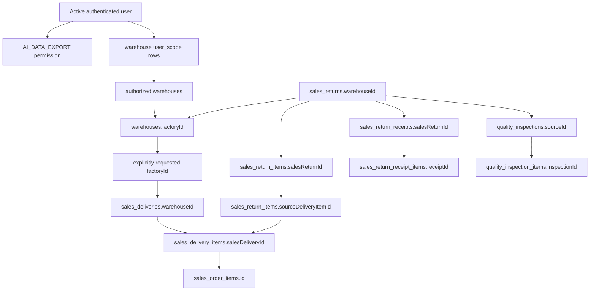

# Furnexa AI Factory Boundary Contract V1

**Status:** Design-only contract. It defines required SQL relationships for a future export service.

## Authoritative Attribution Chain

The only current direct Sales warehouse attribution is:

```text
sales_deliveries.warehouseId
  -> warehouses.id
  -> warehouses.factoryId
  -> factories.id
```

Sales Return attribution is:

```text
sales_returns.warehouseId
  -> warehouses.id
  -> warehouses.factoryId
  -> factories.id
```

The complete relationship chain is:



## Session to Factory Resolution

For a non-admin user:

1. Load warehouse scopes from `user_scopes` for the active user.
2. Load matching warehouse rows.
3. Require at least one warehouse scope.
4. Load `warehouses.factoryId` for those warehouse IDs.
5. Resolve the explicitly requested factory.
6. Retain only warehouses whose `warehouse.factoryId = requestedFactoryId`.
7. Require at least one retained warehouse.

For System Admin, no unrestricted SQL bypass is authorized by this design. The policy must resolve a scope first. Option C or a controlled Option A/B is required.

## SQL: Delivery Fact

Conceptual parameterized SQL:

```sql
SELECT
  f.id AS factoryId,
  w.id AS warehouseId,
  sd.id AS deliveryId,
  sdi.id AS deliveryItemId,
  sd.deliveryDate,
  sd.inventoryPosted,
  sd.status AS deliveryStatus,
  sdi.salesOrderItemId,
  soi.salesOrderId,
  COALESCE(sdi.productId, soi.productId, soi.itemId) AS productId,
  sdi.variantId,
  sdi.deliveredQuantity,
  sdi.unitId,
  sdi.baseQuantity,
  sdi.baseUnitId,
  sdi.unitConversionFactor,
  sdi.inventoryIdentityKind,
  sdi.identitySnapshotStatus
FROM sales_deliveries sd
JOIN warehouses w ON w.id = sd.warehouseId
JOIN factories f ON f.id = w.factoryId
JOIN sales_delivery_items sdi ON sdi.salesDeliveryId = sd.id
JOIN sales_order_items soi ON soi.id = sdi.salesOrderItemId
WHERE sd.status = 'DELIVERED'
  AND sd.inventoryPosted = 1
  AND f.id = :factoryId
  AND w.id IN (:authorizedWarehouseIds)
  AND soi.salesOrderId = (
    SELECT salesOrderId FROM sales_deliveries parent
    WHERE parent.id = sd.id
  )
  AND sdi.identitySnapshotStatus = 'VERIFIED'
  AND sdi.productId IS NOT NULL
  AND sdi.baseUnitId IS NOT NULL
  AND sdi.unitConversionFactor IS NOT NULL;
```

The exact implementation should use a parameter library and placeholder generation suitable for SQLite. The SQL is illustrative, not executable schema guidance.

### Delivery rejection rules

Reject the row unless:

- Delivery warehouse joins exactly one existing warehouse.
- Warehouse joins exactly one existing factory.
- Warehouse factory equals the request factory.
- Warehouse is in the resolved authorized warehouse set.
- Delivery status is `DELIVERED`.
- `inventoryPosted = 1`.
- Delivery item has exactly one parent delivery.
- Delivery item order line exists.
- Order line belongs to the delivery's `salesOrderId`.
- Identity kind and snapshot status are verified.
- Product/variant/base-unit fields are consistent and unambiguous.

## SQL: Accepted Sales Return Fact

The return fact must join only verified return, source delivery, receipt, inspection, and item chains:

```sql
SELECT
  f.id AS factoryId,
  sr.warehouseId,
  sr.id AS salesReturnId,
  sri.id AS salesReturnItemId,
  sr.returnDate,
  sri.productId,
  sri.variantId,
  sri.baseQuantity,
  sri.unitId,
  sri.baseUnitId,
  sri.unitConversionFactor,
  sri.qualityStatus,
  qii.acceptedBaseQuantity,
  qii.rejectedBaseQuantity,
  qii.quarantinedBaseQuantity
FROM sales_returns sr
JOIN warehouses w ON w.id = sr.warehouseId
JOIN factories f ON f.id = w.factoryId
JOIN sales_return_items sri ON sri.salesReturnId = sr.id
JOIN sales_delivery_items source_di
  ON source_di.id = sri.sourceDeliveryItemId
JOIN sales_deliveries source_sd
  ON source_sd.id = source_di.salesDeliveryId
JOIN sales_return_receipts rr
  ON rr.salesReturnId = sr.id
JOIN sales_return_receipt_items rri
  ON rri.receiptId = rr.id
 AND rri.salesReturnItemId = sri.id
JOIN quality_inspections qi
  ON qi.sourceType = 'SALES_RETURN'
 AND qi.sourceId = sr.id
 AND qi.status = 'COMPLETED'
 AND qi.warehouseId = rr.warehouseId
JOIN quality_inspection_items qii
  ON qii.inspectionId = qi.id
 AND qii.sourceReturnItemId = sri.id
WHERE sr.status = 'COMPLETED'
  AND f.id = :factoryId
  AND w.id IN (:authorizedWarehouseIds)
  AND rr.warehouseId = sr.warehouseId
  AND source_sd.warehouseId = sr.warehouseId
  AND source_sd.salesOrderId = sr.salesOrderId
  AND source_sd.status = 'DELIVERED'
  AND sri.identitySnapshotStatus = 'VERIFIED';
```

This is a proposed export query shape. It must be checked against the exact current Sales Return posting implementation and any current status/receipt semantics before coding.

### Accepted-return rejection rules

An accepted quantity can enter the export only if:

- Return status is completed/accepted by the future-approved export contract.
- Return warehouse equals source/receipt/inspection warehouse chain.
- The source delivery item exactly links to the return item.
- Source delivery belongs to the return order and return warehouse.
- Source delivery is delivered and inventory-posted where posting evidence is defined.
- A receipt item exists for the return item.
- A completed quality inspection exists.
- Inspection warehouse matches the receipt/return chain.
- Inspection item is linked to exactly the return item.
- Accepted/rejected/quarantined base quantities reconcile to the inspected base quantity.
- Accepted quantity has completed transfer/posting evidence under the existing Sales Return posting implementation.

Rejected and quarantined quantities remain separate export fields/status events. They never reduce delivered demand.

## Missing/Zero Observation Contract

- `sales_deliveries.deliveryDate` identifies an observed delivery period.
- No Sales delivery row does not itself prove observed zero demand.
- A period may be missing because source data has no coverage, a historical period has no verified record, or export identity verification excluded data.
- The fact service must return a coverage manifest separately.
- Missing periods must not be converted to zero demand.
- Verifiable unavailable/stockout periods require a separate, product-approved ledger rule. The minimum contract does not infer stockout from absence of Sales rows.

## Cross-Factory and Cross-Warehouse Rejection

A fact is blocked if:

- Parent and source warehouses differ for a delivery-linked return.
- Return receipt warehouse differs from return warehouse.
- Inspection warehouse differs from receipt/return warehouse.
- Return item source delivery item belongs to another order or warehouse.
- Delivery item order line belongs to a different order than the delivery header.
- A warehouse's factory differs across joins or the warehouse appears in two inconsistent factory chains.
- A return item has no source delivery and its accepted quantity cannot be reconciled to delivered stock.
- Delivery product/variant/base-unit identity is unverified or inconsistent.

## Relationship Matrix

| Relationship | Existing proof | Export requirement |
|---|---|---|
| User -> warehouse | `user_scopes(scopeType=WAREHOUSE)` | Exact resolved and non-empty set |
| Warehouse -> factory | `warehouses.factoryId -> factories.id` | Exactly one joined factory per warehouse |
| Delivery -> warehouse/factory | Prompt 23 plus schema | Factory and warehouse predicates in SQL |
| Delivery item -> delivery/order item | Foreign keys | Exact parent and order consistency |
| Return -> warehouse/factory | Prompt 23 plus schema | Return warehouse must match selected factory |
| Return -> source delivery | Nullable link plus Prompt 23 validation | Non-null for accepted export facts; exact order/warehouse match |
| Return -> receipt | Receipt foreign key | Receipt and receipt item exact parent chains |
| Return -> QC | Generic source fields plus Prompt 23 validation | Exact `SALES_RETURN/sourceId`, warehouse, and source return item |
| Delivery/return -> accepted quantity | Posting implementation | Future implementation must verify reconciled posting evidence |

## Not in the Minimum Contract

Do not join or use for demand quantity:

- Quotations
- Sales orders alone
- Sales invoices
- Customer-level Sales summaries
- Global product summaries
- `inventory_valuations`
- Accounting journal entries
- Quarantined/rejected quantity as demand reduction

## Contract Decisions Requiring Approval

- Whether the export requires all matched facts to resolve or allows an exclusion manifest.
- Whether `COMPLETED` is the definitive accepted-return status or another posting status is required.
- Whether `inventoryPosted = 1` alone is sufficient posting evidence or an exact stock transaction/reference is mandatory.
- Whether a historical null QC source link may be exported after parent-chain verification.
- Factory coverage policy for inactive warehouses and quarantine warehouses.
- Minimum accepted quantity precision and reconciliation tolerance.