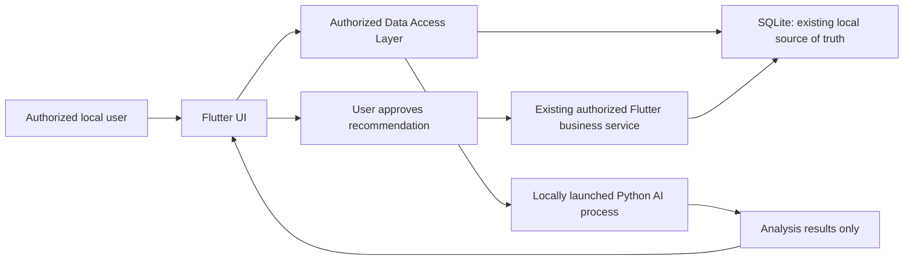

# Furnexa AI Local Data Access Design V1

**Status:** Design only. No implementation, export service, database access, snapshot, migration, or application change was made.

## 1. Deployment Model

Verified product constraints:

- One Furnexa installation serves one factory.
- Each installation has its own local SQLite database.
- The Furnexa Flutter Desktop application and the local AI module run alongside one another.
- SQLite is the single source of truth for business records.
- Python is an analysis process, not a business-system database client.
- AI recommendations are advisory and never execute a business operation automatically.

The system is therefore not a cross-factory export architecture. Factory isolation is supplied primarily by database ownership and a read-only local extraction boundary.

## 2. Target Architecture

### Boundaries

1. Flutter authenticates the user and invokes existing repository/data-source authorization.
2. The data access layer reads only approved, required fields from local SQLite.
3. Flutter pseudonymizes or tokenizes identifiers before sending the payload to Python where that is practical.
4. Flutter sends a limited JSON payload over loopback only.
5. Python validates, analyzes, and returns results or an error.
6. Python has no SQLite dependency or write capability.
7. Flutter displays results and waits for explicit user confirmation before any existing business operation is called.

## 3. Verified Existing Components

- The Flutter application opens a local SQLite database through `FurnexaDatabase` and `DatabasePathResolver`.
- `FurnexaDatabase.instance.database` is the shared application database source.
- The Windows deployment normally resolves `%LOCALAPPDATA%/Furnexa/furnexa.db` unless a supported test/development/environment override applies.
- `SecurityLocalDataSource` provides active-session authentication, role permissions, warehouse scopes, and audit logging.
- Sales delivery and return reads have SQL-level warehouse predicates in the Prompt 23 fix.
- `audit_logs` is immutable on update/delete and already supports export-style audit entries.
- The existing AI workspace has demand preprocessing and forecasting code operating on tabular model inputs; it does not contain a database writer or local HTTP service.
- The existing Import/Export datasource reads module tables globally and requires `SYSTEM_ADMIN`; it is not an appropriate implementation base for AI data access.

## 4. Authorization at the Data Access Layer

The future AI request should require:

- An active authenticated user.
- An active role.
- Existing Sales/Return/QC read permission(s) appropriate to the requested contract.
- A Prompt 23-style warehouse scope result or explicit local-ownership policy.
- A request type that is allow-listed.
- A validated date range and identity allow-list.
- No raw SQLite table or SQL input from the UI.

Under the confirmed one-factory model, the export boundary does not need a cross-factory factory ID or cross-factory role. The local database's factory is the implicit source scope. Warehouse scope should still be honored for authorized internal users where the dataset includes warehouse-level Sales data.

The AI request must deny the payload if:

- The session is inactive or missing.
- Required Sales/Return permissions are missing.
- Prompt 23 warehouse scope resolves to no authorized rows.
- Required parent/child relationships cannot be verified.
- Identity or posting mappings are invalid.
- The requested period exceeds a validated payload limit.

## 5. Transport

The simplest deployment is a process launched by Flutter:

- Flutter starts the existing Python `.venv` interpreter and an approved local analysis entry script.
- The script binds only to `127.0.0.1`.
- Flutter chooses an unused ephemeral loopback port or receives a dynamic port from the process.
- A random per-process bearer token or shared secret is generated in Flutter and supplied to Python.
- Python requires the token on every request.
- No zero-configuration external listening address is permitted.
- The AI endpoint must not expose health or analysis functions to non-loopback interfaces.

The transport payload should be sent as JSON over localhost HTTP or passed through a local IPC mechanism. HTTP is acceptable if it is loopback-bound and authenticated. Named pipes are optional and do not remove the need for payload validation.

## 6. Data Flow

A Sales forecast request has this flow:

1. Flutter receives a user-approved analysis request.
2. The existing authorized Sales/Return data source verifies session and read permissions.
3. Flutter executes a fixed allow-listed query with a validated period and identity list.
4. Flutter maps output fields to opaque tokens or stable local analysis keys.
5. Flutter builds a versioned JSON contract containing observations and coverage flags only.
6. Flutter sends the contract to the loopback AI process.
7. Python validates field names, types, date range, limits, and duplicate identities.
8. Python runs the existing forecasting logic and returns forecasts plus a contract-valid result manifest.
9. Flutter displays the recommendation.
10. No result is applied until a separate, explicitly approved Flutter business operation executes.

## 7. Payload Principles

The AI payload must include:

- Contract and mapping version.
- Analysis purpose.
- Period.
- Warehouse, product, and variant identity tokens.
- Observation date or shifted date approved by product policy.
- Gross delivered base quantity.
- Accepted return base quantity.
- Net base quantity.
- Observed coverage flag.
- Demand state: `missing`, `observed_zero`, or `observed_positive`.
- Explicit excluded-row and missing-period counts in the manifest.

The payload must not include:

- Customer data.
- Contact or employee data.
- Driver, vehicle, or destination data.
- Notes or free text.
- Prices, invoices, quotations, or order totals unless separately approved.
- Raw source IDs or direct SQL.
- Database path or database credentials.
- Model-generated instructions or executable business operations.

## 8. Python Responsibilities

Python may:

- Validate the allow-listed JSON payload.
- Transform data into a forecasting grid.
- Calculate forecasts, coverage, uncertainty, and diagnostics.
- Return machine-readable recommendations and data-quality flags.

Python may not:

- Open SQLite or any Furnexa database.
- Import the Furnexa data source or execute SQL.
- Read arbitrary files based on request paths.
- Write business records.
- Call existing Furnexa mutation services.
- Trigger ordering, purchasing, production, accounting, or inventory actions.
- Persist row-level data without an approved contract and cleanup policy.

## 9. Local Database Retention

SQLite remains unchanged. No AI cache or write service should modify the business database. Temporary payload or result files are unnecessary for the smallest implementation and should be avoided. If temporary files become necessary, they must:

- Exist only in the local OS temp directory.
- Be created with restrictive permissions.
- Use a random unique name.
- Be deleted in `finally`/shutdown paths.
- Be excluded from audit and result payloads.

## 10. Audit

Use the existing `audit_logs` mechanism for:

- Analysis request start.
- User and active role snapshot.
- Contract and mapping versions.
- Date range.
- Warehouse/identity scope summary.
- Row count and excluded-row counts.
- Success, validation failure, timeout, or process failure.
- Result hash or opaque result ID, not raw recommendations unless approved.

The audit must not contain payload row data or local database paths.

## 11. Verification Scope

No production database or business row was accessed. No snapshot or payload was generated. No source code or schema was changed. Existing `.venv` was not recreated or activated.