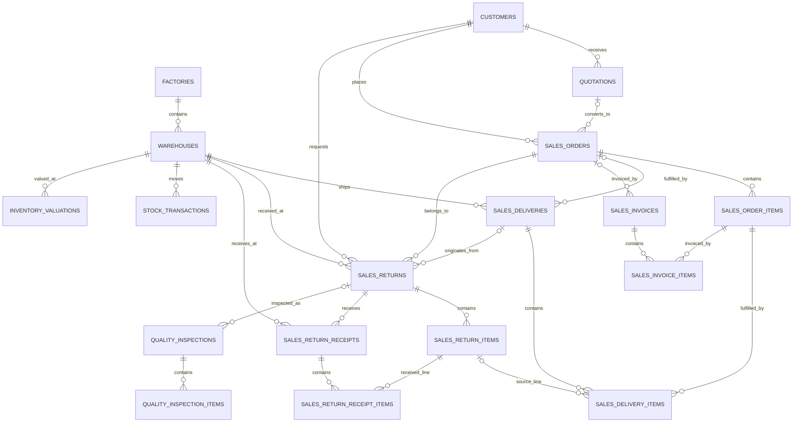

# Furnexa Sales Factory Export Boundary Audit V1

**Audit date:** 2026-11-21  
**Scope:** Read-only audit of Sales data paths. No exporter, migration, business logic, database write, production database access, or AI experiment modification was performed.

## Executive Result

A complete, accurate, factory-scoped Sales snapshot is **not currently possible** through the existing schema and authorization model.

A partial snapshot is conditionally possible only from **posted, delivered inventory lines** and **accepted, completed Sales Return receipts**, each proven to belong to an authorized warehouse and its `warehouse.factoryId`. Prompt 23 does not secure a factory export boundary for all Sales entities, and it does not add an AI-export permission or audit trail.

## 1. Prompt 23 Guarantees

Prompt 23 is the `Sales Delivery and Return Read-Scope Security Fix V1`. Its verified guarantees are narrower than the title of this audit:

- `sales.deliveries(orderId)` requires `SALES_VIEW` and constrains results to the active session's warehouse grants. Empty non-admin scope returns no rows.
- The Sales warehouse picker returns only authorized active sellable warehouses.
- Delivery warehouse validation checks the active session grant.
- Sales Return listing is SQL-constrained to authorized `sales_returns.warehouseId` values.
- Return source-delivery and source-line selection are SQL-constrained to authorized warehouses.
- Return detail items, receipts, receipt items, and Sales Return QC child reads require authorized parent relationships and reject inconsistent or missing delivery links.
- Cross-factory tests cover authorized and unauthorized deliveries/returns, empty scope, order-based delivery lookup, warehouse pickers, child reads, malformed links, and system-admin behavior.

Prompt 23 does **not** establish:

- A direct factory scope in `ScopeType`; scopes remain warehouse/section/workshop/stage.
- Authorization for quotations, sales orders, order items, invoices, invoice items, or order-level summaries.
- A dedicated AI export permission, AI export service, or export audit event.
- Authorization for every stock transaction or valuation read.
- A guarantee that every order/delivery/invoice is one-factory.
- Net-demand semantics or historical-period completeness.

## 2. Schema and Entity Relationship Map

### Entity detail

| Entity | Primary key | Relevant foreign keys | Warehouse/factory relationship | Parent/child | Read/query authorization |
|---|---|---|---|---|---|
| Quotations | `quotations.id` | `customerId -> customers.id` | None directly | Header; `quotation_items.quotationId` | `SalesLocalDataSource.quotations()` requires `SALES_VIEW`, but there is no warehouse/factory predicate. |
| Quotation items | `quotation_items.id` | `quotationId -> quotations.id`, `unitId -> units.id`; `itemId`/`itemType` identify product or raw material | Only indirectly through quotation, which has no warehouse/factory | Child of quotation | Loaded by parent; no independent factory scope. |
| Sales orders | `sales_orders.id` | `customerId -> customers.id`, nullable `quotationId -> quotations.id` | None directly | Header; order items children | `orders()` requires `SALES_VIEW`, but reads all matching orders with no warehouse/factory predicate. |
| Sales order items | `sales_order_items.id` | `salesOrderId -> sales_orders.id`, `unitId -> units.id` | Indirect only through deliveries or a future verified delivery mapping | Child of order | Loaded by parent; no independent factory scope. |
| Sales invoices | `sales_invoices.id` | `salesOrderId -> sales_orders.id`, `customerId -> customers.id` | None directly | Header; invoice items children | No dedicated invoice read audit or warehouse/factory filter found. Issuance requires `SALES_EDIT` and `ACCOUNTING_POST`, not read scope. |
| Sales invoice items | `sales_invoice_items.id` | `salesInvoiceId -> sales_invoices.id`, `salesOrderItemId -> sales_order_items.id`, `unitId -> units.id` | Indirect only through order and delivery; no direct or reliable delivery link | Child of invoice | No independent read scope. |
| Sales deliveries | `sales_deliveries.id` | `salesOrderId -> sales_orders.id`, `warehouseId -> warehouses.id` | Directly: `warehouseId -> warehouses.factoryId -> factories.id` | Header; delivery items children | Prompt 23 scopes delivery-by-order and picker reads to authorized warehouse IDs; writes also have warehouse checks. |
| Sales delivery items | `sales_delivery_items.id` | `salesDeliveryId -> sales_deliveries.id`, `salesOrderItemId -> sales_order_items.id`, `unitId -> units.id` | Direct through parent delivery's warehouse/factory | Child of delivery and order item | Must be read through a scoped parent delivery. Migrated snapshot columns can carry product, variant, base unit, conversion, and verification status. |
| Sales returns | `sales_returns.id` | `salesOrderId -> sales_orders.id`, nullable `salesDeliveryId -> sales_deliveries.id`, `customerId -> customers.id`, `warehouseId -> warehouses.id` | Direct: `warehouseId -> warehouses.factoryId` | Header; return items, receipts, and QC descendants | Prompt 23 scopes list/details and validates optional delivery consistency. |
| Sales return items | `sales_return_items.id` | `salesReturnId -> sales_returns.id`; later migration adds `sourceDeliveryItemId`, product/variant/unit snapshot fields | Direct through parent return warehouse and verified source delivery item | Child of return | Prompt 23 scopes parent and source links. |
| Return receipts | `sales_return_receipts.id` | `salesReturnId -> sales_returns.id`, `warehouseId -> warehouses.id` | Direct through receipt and parent return warehouse; must match | Header; receipt items children | Prompt 23 requires receipt warehouse and parent return warehouse to be authorized and consistent. |
| Receipt items | `sales_return_receipt_items.id` | `receiptId -> sales_return_receipts.id`, `salesReturnItemId -> sales_return_items.id` | Direct through receipt and return parent | Child of receipt/return line | Prompt 23 scopes both parent chains. |
| Quality inspections | `quality_inspections.id` | Generic `sourceType` + `sourceId`; nullable `warehouseId`; later Sales/receipt links | For Sales returns, warehouse must be verified through parent/inspection warehouse and source return | Header; inspection items children | Prompt 23 scopes Sales Return inspections and child links to authorized return and warehouse relationships. |
| Quality inspection items | `quality_inspection_items.id` | `inspectionId -> quality_inspections.id`; later source return item/receipt item fields | Through parent inspection and optional source links | Child of inspection | Prompt 23 requires non-null source links to belong to the scoped return and excludes cross-return items. |
| Stock transactions | `stock_transactions.id` | `warehouseId -> warehouses.id`, `unitId -> units.id`; item identity is generic `itemId/itemType`, later product/variant fields | Direct warehouse/factory; item/product identity may require snapshot or catalog joins | Ledger leaf | Warehouse Stock reads vary; no complete Sales-specific authorization audit established. |
| Inventory valuations | `inventory_valuations.id` | `warehouseId -> warehouses.id`; item identity generic, later product/variant/base unit fields | Direct warehouse/factory | Current stock valuation leaf | Dashboard queries apply session warehouse scope for specific reports, but a global direct read could not be presumed scoped. |

## 3. Business Semantics

- **Quotation:** an offer, not demand delivered or guaranteed to be sold.
- **Sales order:** a commercial commitment and/or requested quantity, not physical delivery. `deliveredQuantity` and delivery items must be used to separate confirmed demand from future or partial fulfillment.
- **Sales invoice:** financial billing, not proof of physical delivery. It can overlap with or precede/follow operational delivery depending on process; it must not be used as demand quantity without a verified delivery relationship.
- **Sales delivery:** a physical dispatch event. Only a delivered posting, matched to an inventory movement, represents observed outbound demand.
- **Inventory posting:** separate from the delivery header. `sales_deliveries.inventoryPosted` and matching stock transactions determine whether the physical movement is complete; delivery without a verified post must be excluded from a minimum delivered-demand fact.
- **Sales return request:** a pending customer-return record, not an accepted net-sales reduction.
- **Received return:** a receipt against a Sales return, but accepted demand adjustment is only after complete QC/reconciliation/posting.
- **Approved/rejected/quarantined return:** approved/accepted quantities reduce demand only when fully posted and traceable. Rejected and quarantined quantities remain separate and must not reduce demand or be counted as accepted inventory return.
- **QC accepted/rejected quantity:** QC item fields are the closest quantity split. Header status alone is insufficient; item-level accepted/rejected/quarantined quantities and parent posting evidence are required.
- **Physical stock movement:** `stock_transactions`/stock balance. **Accounting movement:** journal entries/inventory valuation. Neither replaces delivery evidence.

## 4. Factory Attribution Analysis

### Proven direct path

`sales_deliveries.warehouseId -> warehouses.id -> warehouses.factoryId -> factories.id`

This is proven by foreign keys in the schema and joins in the Sales and Dashboard data sources. The delivery item's factory is inherited from its parent delivery.

### Proven return path

`sales_returns.warehouseId -> warehouses.factoryId`. For an original delivery, Prompt 23 proves the return's delivery must have the same order and warehouse and the sales return header must match the delivery relationship. Return receipts must share the same authorized return and warehouse chain.

### Ambiguity and risk

- The order, quotation, invoice, and order-item entities have no direct warehouse or factory foreign key.
- An order can have deliveries in multiple warehouses/factories. `sales_orders` therefore cannot be assigned unambiguously by order header alone.
- Invoice items link to order items but have no invoice warehouse and no delivery link. A multi-factory order/invoice can contain lines without a proven factory split.
- A Sales Return has a nullable `salesDeliveryId`, so a return without a verified delivery is not sufficient demand evidence. Prompt 23 allows a null delivery for compatibility in some return structures, but export cannot infer delivery origin from UI context.
- A return line's `sourceDeliveryItemId` can identify the originating delivery. It must be verified against return order, return warehouse, source delivery warehouse, and source delivery item. Missing or cross-line links block export.
- Quality Inspection has a generic `sourceType/sourceId` and nullable warehouse. Sales Return attribution is possible only through the verified parent chain and inspection warehouse consistency.
- Stock transactions and valuations use direct warehouse attribution, but product/variant identity and historical snapshot status can be inconsistent or legacy. Direct attribution does not prove that a movement is a Sales delivery or accepted return.
- Orphan deliveries/returns/receipts/inspections can exist if direct foreign keys are missing or links are stale in synthetic or legacy data. Current Prompt 23 tests include invalid return/delivery relationships and fail closed.
- Cross-warehouse return receipts and cross-factory inspection items are explicitly testable and must be excluded rather than merged.

### Minimum attribution rules

1. Delivery fact: delivery exists, header warehouse exists, warehouse maps to exactly one factory, and the delivery item has an exact parent delivery and order-item relationship.
2. Delivery posting: `inventoryPosted = 1` and a matching physical stock transaction or documented posting reference must be required before export if posting status is operationally reliable.
3. Accepted return: return, receipt, and QC/inspection chains all resolve to the same authorized factory, plus accepted quantity is separately proven by completed/reconciled posting.
4. Rejected/quarantined return: retained only as a separate event/status, never subtracted from delivered demand.
5. Inventory stockout: include only with a verifiable time-bounded stock/warehouse availability history. The current schema may support stock balances/transactions but no complete demand-period coverage guarantee was established.

## 5. Export Boundary Matrix

| Entity | Factory attribution | Authorization | AI export decision | Reason |
|---|---|---|---|---|
| Quotations | Not available | `SALES_VIEW` only; global quote list in source | Blocked | No warehouse/factory link; not confirmed demand. |
| Quotation items | Only through header | Parent not scoped | Blocked | Header has no factory; child cannot be attributed. |
| Sales orders | Not available | Global `orders()` read under `SALES_VIEW` | Blocked | No warehouse/factory column and order may span warehouses/factories. |
| Sales order items | Unverified through eventual delivery | Parent order not scoped | Blocked | No direct warehouse/factory link. |
| Sales invoices | Not available | Invoice issuance has edit/accounting permissions, not read scope; no scoped invoice read | Blocked | Invoice is financial; no warehouse/factory attribution. |
| Sales invoice items | Ambiguous through order item | Parent invoice/order not scoped | Blocked | No direct delivery/factory link. |
| Sales deliveries | Proven through warehouse/factory join | Prompt 23 scopes warehouse reads for scoped users; system admin remains intentionally unrestricted | Conditional | Use only with a purpose-specific AI export authorization and SQL-time factory/warehouse predicate. |
| Sales delivery items | Proven through scoped delivery parent | Prompt 23 does not create an AI export path | Conditional | Require posted status, verified product/variant/base identity, and exact source delivery/order item. |
| Sales returns | Proven through return warehouse/factory and verified delivery | Prompt 23 scopes listing/details | Conditional | Include only verified/consistent records and a dedicated export permission. |
| Sales return items | Proven through parent return plus source delivery item | Prompt 23 scopes parent/source relationships | Conditional | Separate request, received, accepted, rejected, and quarantined quantities. |
| Return receipts | Proven through warehouse and parent return | Prompt 23 validates authorized parent/receipt warehouses | Conditional | Receipt alone is not accepted return. |
| Receipt items | Proven through receipt and return chain | Prompt 23 scopes child chain | Conditional | Require reconciliation to a return item and accepted QC/posting status. |
| Quality inspections | Possible through parent Sales Return and inspection warehouse | Prompt 23 scopes Sales Return inspections | Conditional | Generic source fields make unverified rows ambiguous; retain item-level statuses and exclude null/unresolved links. |
| Quality inspection items | Through parent inspection and source-return item | Prompt 23 scopes source return item | Conditional | Only accepted/rejected/quarantined quantities from verified completed inspections. |
| Stock transactions | Proven warehouse/factory | Warehouse reads require separate authorization checks | Conditional | No Sales intent in the row alone; use as posting evidence only, not an independent demand fact. |
| Inventory valuations | Proven warehouse/factory | Dashboard warehouse scope exists; global read not proven | Blocked | Financial valuation is not demand, and snapshot identity/status must be resolved. |

## 6. Minimum Safe Sales Snapshot

The minimum reliable demand fact should be **one row per verified delivered product/variant unit, factory, warehouse, delivery date, and inventory posting status**, plus an explicitly linked accepted-return fact for net-demand use.

### Required fields

- `factoryId`
- `warehouseId`
- `deliveryId`
- `deliveryItemId`
- `deliveryDate`
- `salesOrderId`
- `salesOrderItemId`
- `productId`
- nullable `variantId`
- `deliveredQuantity` in source unit
- `unitId`
- `baseUnitId`
- `unitConversionFactor`
- `baseQuantity`
- `inventoryIdentityKind`
- `identitySnapshotStatus`; snapshot status must be `VERIFIED` for safe quantity/export use unless a separately approved legacy normalization is implemented
- `inventoryPosted`
- physical posting reference/status if available
- accepted-return quantity in base unit
- rejected/quarantined quantity in base unit
- accepted-return posting status/reference
- missing-period indicator
- stockout/unavailable-period indicator only if derived from verifiable time-bounded warehouse ledger evidence

### Delivery-date rule

Use `sales_deliveries.deliveryDate`, not `sales_orders.orderDate`, `sales_orders.expectedDeliveryDate`, or `sales_invoices.invoiceDate`.

### Product/variant rule

Prefer the delivery item's snapshot fields and require consistency with the parent order line and product catalog. Unverified legacy identities must be excluded until normalized. A missing variant is unambiguous only for a product-level identity; infer no variant from UI selection or defaults.

### Warehouse/factory rule

Include only deliveries whose warehouse is active in the exported factory and whose warehouse/factory relationship is exactly one row. Exclude orphan and mismatched warehouse links.

### Source entities to include

- `sales_deliveries`
- `sales_delivery_items`
- `sales_order_items` only as a verified parent line and product identity bridge
- `sales_orders` only for order identity/status checks, never as factory ownership or demand
- `sales_returns`, `sales_return_items`, `sales_return_receipts`, `sales_return_receipt_items` only for verified accepted-return subtraction
- `quality_inspections` and `quality_inspection_items` only for accepted/rejected/quarantined split verification
- `stock_transactions` only as posting evidence or stockout ledger evidence
- `warehouses` and `factories` for attribution

### Source entities to exclude from demand quantity

- Quotations and quotation items
- Sales orders/order items as demand totals
- Sales invoices/invoice items
- Rejected, cancelled, pending, or quarantined return requests
- Financial/accounting movements and inventory valuations as demand quantities
- `stock_balances` as historical period facts unless snapshot history is proven

### Double-counting controls

- Count a delivery item once; do not also count its order quantity or invoice quantity.
- Count accepted returns once from the accepted post fact, not also from request quantity, received quantity, QC requested quantity, or inventory stock transaction all at once.
- Do not count rejected/quarantined quantities as accepted returns.
- Do not count every stock transaction as demand. Reconcile by reference/status to delivery or return posting.
- Preserve both gross delivered quantity and net accepted-return quantity rather than mixing them into one ambiguous target.

### Missing periods and stockouts

No complete period history can be claimed from an entity-by-entity export without a defined observation period and coverage manifest. Missing periods must be marked unless the source proves activity/zero-activity coverage. A stockout/unavailable period is includable only from verifiable stock transaction/availability evidence and must identify the warehouse, product/variant, unit, start/end time, and source rule.

## 7. Remaining Security Findings

### P0: No AI export boundary

There is no purpose-specific AI export permission or trusted export service. Prompt 23 improves app reads but does not authorize factory-scoped data extraction.

### P0: System administrator cross-factory behavior

The existing system-admin rule is intentionally unrestricted. For AI export, the product must define whether an admin is authorized for a selected factory and an export permission must be checked. Existing cross-factory admin reads cannot automatically become export consent.

### P0: Order, invoice, and dashboard summary paths

- `SalesLocalDataSource.orders()` reads `sales_orders` globally under `SALES_VIEW`.
- `sales_orders` has no warehouse/factory field, and one order can span deliveries/factories.
- Invoice issuance is not scoped to a warehouse/factory. No invoice read boundary was found.
- Dashboard order, customer, product, and outstanding-sales reports have order-level SQL with no warehouse/factory predicate.
- Global search searches sales orders globally under `SALES_VIEW` and exposes order-level results.

These remain P0 for export use and can also leak order-level summaries across a factory boundary.

### P1: Generic and direct stock reads

Stock ledger and stock balance queries accept a warehouse/item pair; authorization is method-dependent. A caller can supply arbitrary IDs unless the method checks scope itself. Export must not reuse UI stock methods without SQL-level factory/warehouse predicates and authorization.

### P1: Quotation and customer reads

Quotations have no warehouse/factory attribution and the quote list reads globally under `SALES_VIEW`. Customers are also not Sales-factory entities in the schema.

### P1: Legacy and null source links

Null delivery links and null inspection warehouse/source links require explicit compatibility rules. They must block snapshot export even if a UI can display them.

### P1: Identity snapshot gaps

Migrated Sales delivery/order data includes verification and identity fields, but historical rows can remain `UNVERIFIED` or inconsistent. The snapshot specification must exclude or isolate these rows; a partially normalized product/variant join is not safe.

## 8. Verification Report

### Security tests

- `test/sales_read_scope_security_test.dart` was rerun in the current Furnexa workspace.
- The run reached all security cases, including cross-factory deliveries/returns, no-scope behavior, detail/receipt/QC child scoping, malformed links, and system-admin behavior, and reached `+8` during the run.
- The terminal command was moved to background after a 10-second process timeout; the same run did not return a verified final process exit code before this audit write. It is therefore **not reported as a final +9/exit-0 result** beyond the existing Prompt 23 verification artifact.

### Diagnostics

Pylance/VS Code diagnostics reported no errors for:

- `lib/features/sales/data/datasources/sales_local_data_source.dart`
- `lib/features/returns_quality/data/datasources/returns_quality_local_data_source.dart`
- `lib/features/users_roles_permissions/data/datasources/security_local_data_source.dart`
- `test/sales_read_scope_security_test.dart`

### sqlite3.dll/native asset collision investigation

Prompt 23's report documents that the earlier focused run used an isolated copy because an existing Sales test process and shared Windows native-asset cache collided during `sqlite3.dll` copying. No business code or database migration was changed. The current rerun entered the test process and exercised synthetic database setup; no production database or business row was accessed.

No claim is made for a full suite: the full suite was not run and did not complete as part of this audit.

### Read-only constraints

- No production database access.
- No business-row reads.
- No SQLite writes.
- No schema or migration changes.
- No AI export or AI data collection.
- No historical AI experiment artifact was altered.

## 9. Exact Remaining P0 Blockers

1. No AI-specific export permission or factory-scoped export service exists.
2. The authorization model has warehouse grants but no direct factory scope or inherited factory export rule.
3. Sales orders and order items have no direct warehouse/factory owner and can span factories; order/invoice read paths remain globally readable under `SALES_VIEW`.
4. Invoices have no warehouse/factory attribution and no separate delivery relation.
5. Dashboard and global-search order-level reads can expose order summaries outside a factory boundary.
6. The system must define system-admin export behavior rather than inheriting unrestricted app-admin behavior.
7. Period completeness and stockout history are not proven; a complete snapshot cannot claim all historical periods or unavailable periods.

## 10. Recommended Next Implementation Task

Implement a dedicated, read-only, factory-scoped Sales fact service before any exporter:

1. Add an explicit AI/export permission and a purpose-specific export session policy.
2. Resolve each requested factory to authorized warehouses only; deny mixed-factory scopes and stale/ambiguous mappings.
3. Apply warehouse/factory predicates inside parameterized SQL for deliveries and return chains.
4. Join delivery items to verified order items and enforce `VERIFIED` product/variant/base-unit identity or explicitly isolate legacy rows.
5. Require posted delivery evidence and define the accepted-return posting status accepted by Finance/Operations.
6. Produce gross deliveries and accepted/rejected/quarantined returns as separate facts, not order/invoice totals.
7. Emit a coverage manifest for missing periods, excluded identities, and unavailable stockout periods.
8. Add export-specific cross-factory tests and a fixed exit-code verification of the focused security suite.

Until those controls exist, the only defensible export decision is no AI export, or a carefully row-filtered conditional snapshot limited to Prompt 23-protected deliveries and completed Sales Return chains for an explicitly authorized factory.